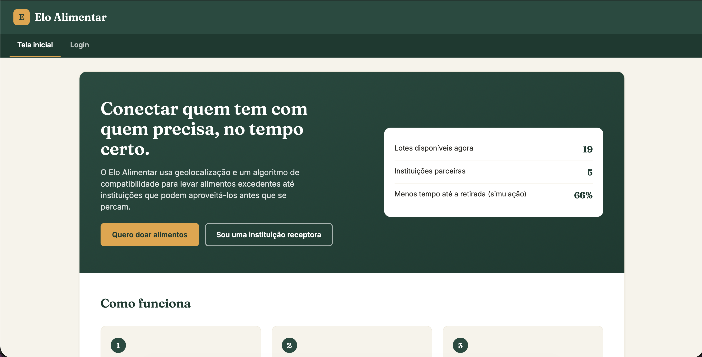
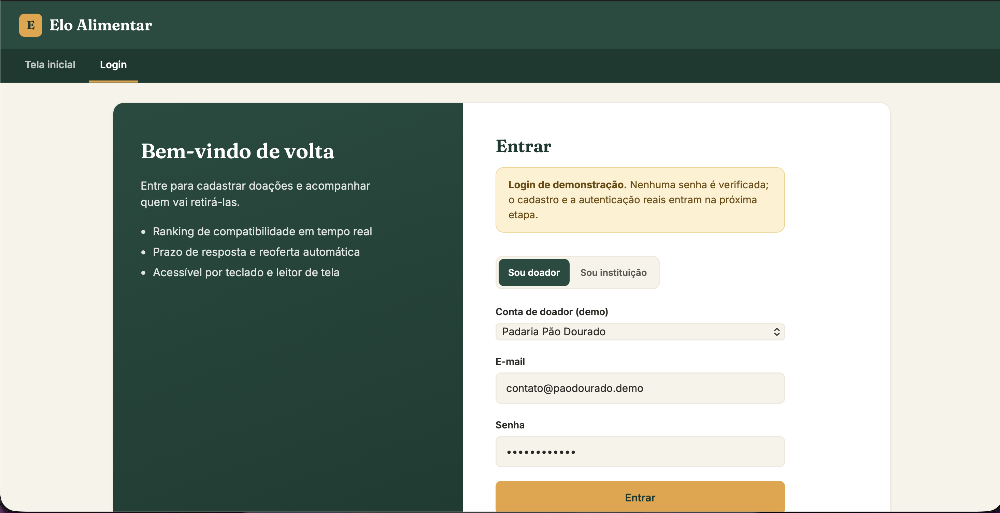
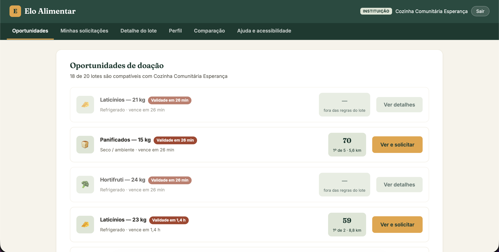

<div align="center">

# 🥗 Elo Alimentar

**Conecta doadores de alimentos excedentes às instituições que mais precisam. O sistema oferece cada doação, uma instituição por vez, na ordem de um ranking que considera distância, validade, necessidade e logística.**


</div>

---

## 📋 Sobre o projeto

Todo dia, comércios e produtores descartam alimentos ainda próprios para consumo, enquanto instituições (cozinhas comunitárias, abrigos, ONGs) têm dificuldade de saber **quem tem o quê, onde e por quanto tempo**. Escolher a instituição "mais próxima" costuma falhar: ela pode não ter refrigeração, estar com o estoque cheio ou ser longe demais para o prazo de validade.

O **Elo Alimentar** resolve isso com um **matching multicritério**: cada lote cadastrado é ranqueado contra as instituições, descartando as inviáveis e ordenando as demais por uma pontuação de 0 a 100. O lote é então **oferecido a uma instituição por vez**, na ordem do ranking; se ela recusar ou não responder no prazo, a oferta segue para a próxima. É o **diferencial deste TCC**, e o projeto traz uma comparação direta com a estratégia ingênua de "só distância".

### ✨ Principais funcionalidades

- 🎯 **Matching multicritério** — proximidade, urgência da validade, **necessidade da instituição** (para quantos dias dura o estoque dela) e compatibilidade logística, com regras eliminatórias (refrigeração, raio de 15 km, chegar antes de vencer, espaço de armazenamento, limite de lotes em aberto).
- 🔁 **Oferta sequencial** — o lote é oferecido à 1ª do ranking, que tem **30 minutos** para aceitar ou recusar. Recusou ou não respondeu? Segue para a próxima, e **quem recusou não recebe o mesmo lote de novo**.
- 📦 **Estoque estimado** — a instituição informa o estoque uma vez; o sistema desconta o consumo diário (pessoas atendidas × 0,5 kg) e soma cada doação retirada. Quem está com o estoque acabando ganha prioridade.
- 🔔 **Notificações** — sininho no app e aviso do navegador: nova oferta, lembrete 10 minutos antes do prazo e, para o doador, aceite, recusa, retirada ou vencimento.
- 📍 **Endereço de retirada** — o doador digita o **CEP** (preenche a rua automaticamente) ou o endereço, e o sistema localiza o ponto no mapa; também dá para marcar direto no mapa.
- 🗺️ **Mapa interativo** (Leaflet + OpenStreetMap) para marcar e conferir o local de retirada.
- ♿ **Acessibilidade** — alto contraste, ajuste de fonte e redução de animações.
- 👥 **Telas por perfil** (doador e instituição).

> ⚠️ **Estado atual:** o login é apenas simulado (escolhe-se a conta numa lista, sem senha) e **as ações não são validadas contra o usuário logado**. Cadastro e autenticação reais (senha com hash, JWT, validação da instituição pelo administrador) estão previstos como próxima etapa. Os dados de exemplo são sintéticos.

### 🔄 Ciclo de vida de uma doação

```
                      oferece à 1ª do ranking            instituição aceita            instituição retira
 AVAILABLE ─────────────────────────────────► OFFERED ─────────────────────► RESERVED ──────────────────► COLLECTED
     ▲                                           │
     └──── recusou, ou 30 min sem resposta ──────┘   (oferece à próxima, sem a instituição que falhou)

 AVAILABLE ou OFFERED ──── a validade passou antes de alguém aceitar ────► EXPIRED
```

| Status | Significado |
|---|---|
| `AVAILABLE` | Sem oferta ativa (esperando uma instituição elegível) |
| `OFFERED` | Oferecido a uma instituição, aguardando a resposta dela |
| `RESERVED` | Aceito; a instituição vai retirar |
| `COLLECTED` | Retirado |
| `EXPIRED` | A validade passou antes de alguém aceitar |

---

## 🎬 Demonstração

<!--
  As capturas de tela abaixo mostram a versão anterior da interface (login de demonstração,
  fluxo de "solicitação", tela de comparação) e foram retiradas do README para não contradizer
  o funcionamento atual. Gere capturas novas, salve em docs/screenshots/ e reative este bloco.

<div align="center">
  
  
  
  
  
  
</div>
-->

Para ver o sistema funcionando, siga o [roteiro de demonstração](#-como-usar-roteiro-de-demonstração).

---

## 🛠️ Tecnologias utilizadas

### Front end (`elo-alimentar-web`)


### Back end (`elo-alimentar-matching-api`)


### Serviços externos (gratuitos, sem chave)
- [**ViaCEP**](https://viacep.com.br) — CEP → rua, bairro, cidade e UF
- [**Nominatim / OpenStreetMap**](https://nominatim.org) — endereço → coordenadas (respeitando a política de uso: 1 consulta por segundo, identificação e cache)

### Ferramentas


---

## 🚀 Começando

### 📦 Pré-requisitos

- [Node.js](https://nodejs.org/) 20 ou superior e npm
- [Git](https://git-scm.com/)
- [Docker](https://www.docker.com/) (somente para a versão com PostgreSQL)
- Internet (o mapa vem do OpenStreetMap, e a busca de CEP e de endereço usa o ViaCEP e o Nominatim; sem internet o cadastro continua funcionando marcando o local direto no mapa)

### 💻 Instalação e execução — modo rápido (sem banco)

Já sobe com 5 instituições e 20 lotes de exemplo. Os dados somem ao reiniciar a API.

1. **Clone o repositório**
   ```bash
   git clone https://github.com/kmarqueees/Elo-Alimentar.git
   cd Elo-Alimentar
   ```

2. **Terminal 1 — API**
   ```bash
   cd elo-alimentar-matching-api
   npm install
   npm run dev:memory        # http://localhost:3333
   ```

3. **Terminal 2 — front end**
   ```bash
   cd elo-alimentar-web
   npm install
   npm run dev               # http://localhost:5173
   ```

4. **Acesse** http://localhost:5173

> Nenhum `.env` é necessário neste modo: todos os valores têm padrão.

### 🐘 Com PostgreSQL (Docker)

```bash
cd elo-alimentar-matching-api
cp .env.example .env
npm install
npm run db:up                  # sobe o PostgreSQL (e cria o banco de testes)
npx prisma migrate deploy      # cria as tabelas (aplica as migrations de prisma/migrations)
npm run db:generate            # gera o Prisma Client
npm run db:seed                # 5 instituições, 20 lotes, 4 doadores e 1 administrador
npm run dev                    # API em http://localhost:3333
```

> ⚠️ O `db:seed` **apaga todos os dados** do banco apontado por `DATABASE_URL` antes de recriá-los.

Depois, suba o front end como no modo rápido (terminal 2).

#### Variáveis de ambiente

Todas já vêm preenchidas no [`.env.example`](elo-alimentar-matching-api/.env.example) da API.

| Variável | Padrão | Para que serve |
|---|---|---|
| `DATABASE_URL` | — | Banco da aplicação (somente `npm run dev`) |
| `TEST_DATABASE_URL` | — | Banco dos testes de integração. **O teste apaga os dados dele** |
| `PORT` | `3333` | Porta da API |
| `OFFER_TIMEOUT_MINUTES` | `30` | Prazo para a instituição aceitar ou recusar uma oferta |
| `OFFER_QUEUE_INTERVAL_MS` | `15000` | De quanto em quanto tempo a fila de ofertas anda (expira, reoferece, lembra) |
| `GEOCODER_USER_AGENT` | `EloAlimentar/1.0` | Identificação enviada ao Nominatim; troque por um contato seu antes de publicar |

O front end só precisa de `VITE_API_URL` (padrão `http://localhost:3333`) se a API estiver em outro endereço; veja o [`.env.example`](elo-alimentar-web/.env.example) dele.

> Se o banco `elo_alimentar_test` não existir (volume do Docker criado antes do script de inicialização), crie-o com:
> `docker exec elo-alimentar-db psql -U docker -d postgres -c "CREATE DATABASE elo_alimentar_test"`

---

## 📖 Como usar (roteiro de demonstração)

Use **duas abas** do navegador para ver os dois lados ao mesmo tempo (a sessão é guardada por aba).

1. **Aba 1, doador:** na tela inicial, *Quero doar alimentos* → escolha **Padaria Pão Dourado** → *Entrar*.
2. **Cadastro de doação:** Panificados, **5 kg**, validade em 2 h, *Seco / ambiente*. Em *Endereço de retirada*, digite o CEP `69005-040`: a rua e o bairro se preenchem sozinhos. Informe o número e clique em **📍 Localizar no mapa**. O marcador vai para o endereço (clique no mapa para ajustar o ponto).
3. **Acompanhar lote:** ao cadastrar, o lote já foi **oferecido à 1ª instituição do ranking**, e a tela mostra para quem, a contagem regressiva de 30 minutos e as próximas da fila.
4. **Aba 2, instituição:** entre como a instituição que aparece como *Oferta atual* na aba do doador. O **sininho 🔔** mostra "Nova doação para você"; clique em *Ativar avisos* para receber também o aviso do navegador.
5. **Ofertas para você:** clique em **Recusar**. Na aba 1, o doador é avisado e a oferta passa para a próxima instituição (a que recusou não recebe esse lote de novo).
6. Entre como a instituição que passou a aparecer como *Oferta atual*, **aceite** a oferta e, em *Minhas retiradas*, **Registre a retirada**. O doador recebe os avisos, e o estoque dela, no **Perfil**, aumenta com o peso do lote.
7. **Perfil da instituição:** veja o estoque estimado e "dura cerca de X dias"; informe o estoque real para corrigir a estimativa. Quanto menos dias o estoque durar, mais prioridade ela recebe nas próximas ofertas.

> 💡 **Por que um lote pequeno e seco?** Os 20 lotes de exemplo já ocupam a maior parte das vagas: cada instituição aceita no máximo 2 lotes em aberto e precisa ter espaço de armazenamento para o novo lote. Um lote **refrigerado** (só 2 das 5 instituições têm refrigeração) ou **grande** cadastrado logo ao iniciar pode ficar *aguardando instituição* (o doador é avisado) até uma vaga abrir, por exemplo quando uma instituição recusa, retira ou deixa a oferta expirar. Um lote pequeno e seco mostra o fluxo completo, inclusive a passagem para a próxima instituição, sem esperar.

Para encurtar o prazo na demonstração:

```bash
OFFER_TIMEOUT_MINUTES=12 npm run dev:memory   # o lembrete chega após ~2 min e a oferta expira em 12
OFFER_TIMEOUT_MINUTES=1 npm run dev:memory    # expiração quase imediata (sem lembrete)
```

### Principais rotas da API

| Método | Rota | Descrição |
|---|---|---|
| `POST` | `/batches` | Doador cadastra um lote (com `address` opcional). Já é oferecido à 1ª do ranking |
| `GET` | `/batches?status=` | Lista lotes (`AVAILABLE`, `OFFERED`, `RESERVED`, `COLLECTED`, `EXPIRED`, `ALL`) |
| `GET` | `/batches/:id` · `/batches/:id/offers` | Detalhe do lote e histórico de ofertas |
| `GET` | `/batches/:id/matches?strategy=` | Fila de instituições do lote (`multicriteria` ou `distance`) |
| `GET` | `/institutions/:id/offers` | Ofertas recebidas pela instituição (sem nota nem posição) |
| `PATCH` | `/offers/:id/accept` · `decline` · `pickup` | A instituição aceita, recusa ou registra a retirada (corpo: `{ "institutionId": "…" }`) |
| `GET` · `POST` | `/institutions` | Lista e cadastra instituições (nascem **não validadas**) |
| `PATCH` | `/institutions/:id/validate` | O administrador valida a instituição |
| `PATCH` | `/institutions/:id/stock` | A instituição informa o estoque real |
| `GET` | `/notifications?recipientId=` | Notificações e contador de não lidas |
| `PATCH` | `/notifications/:id/read` · `/notifications/read-all` | Marca como lida |
| `GET` | `/geocoding/postal-code/:cep` | CEP → rua, bairro, cidade e UF |
| `GET` | `/geocoding/search?q=` | Endereço → pontos no mapa |
| `GET` | `/comparison` | Compara multicritério × só distância (números do TCC) |
| `GET` | `/health` | A API está no ar? |

Exemplos prontos em `elo-alimentar-matching-api/requests.http`.

---

## 🧠 Como funciona o matching

O ranking é calculado em duas etapas: primeiro **eliminam-se** as instituições que não podem receber o lote; depois dá-se uma **nota de 0 a 100** às que restaram. A oferta vai primeiro à de maior nota.

### 1. Filtros eliminatórios

| # | Regra |
|---|---|
| 1 | A instituição foi **validada pelo administrador** |
| 2 | Ela **ainda não recusou nem deixou expirar** uma oferta deste lote |
| 3 | **Refrigeração:** lote refrigerado ou congelado só vai para quem tem refrigeração |
| 4 | Está a **até 15 km** do local de retirada |
| 5 | **Chega antes de vencer:** o deslocamento (30 km/h) é menor que o tempo até a validade |
| 6 | Tem **no máximo 2 lotes em aberto** (oferecidos ou aceitos e ainda não retirados) |
| 7 | O lote **cabe no armazenamento:** estoque estimado + lotes já comprometidos + lote ≤ capacidade |

### 2. Pontuação

| Critério | O que mede | Cálculo | Peso |
|---|---|---|---|
| **Proximidade** | Quanto mais perto, melhor | `1 − distância ÷ 15 km` | 30% |
| **Urgência** | Folga para chegar antes de vencer | `1 − tempo de deslocamento ÷ tempo até vencer` | 30% |
| **Necessidade** | Estoque da instituição acabando | `1` se o estoque dura ≤ 1 dia, `0` se ≥ 7 dias, linear entre os dois | 25% |
| **Compatibilidade** | Encaixe com o lote | 60% capacidade (`espaço livre ÷ quantidade`) + 40% tipo de alimento aceito | 15% |

O peso da **urgência diminui** para lotes com muita validade (cheio até 24 h, zero a partir de 7 dias), e os pesos são **renormalizados** para somar 100%.

### 3. Estoque estimado

```
consumo diário   = pessoas atendidas × 0,5 kg
estoque estimado = último estoque informado − consumo desde então + doações retiradas
dias de estoque  = estoque estimado ÷ consumo diário
```

Quando a instituição informa o estoque real, a estimativa recomeça dele. A retirada de uma doação soma o lote ao estoque por meio de um **evento de domínio** (`DonationCollected`).

O código do algoritmo está em `elo-alimentar-matching-api/src/domain/matching/` (estratégias `MultiCriteriaStrategy` e `DistanceOnlyStrategy`, padrão *Strategy*; os filtros de oferta ficam em `EligibleInstitutionsRanker`, e a oferta em ordem em `SequentialOfferService`).

---

## 🗂️ Arquitetura e estrutura de pastas

O back end segue **Clean Architecture** com conceitos de **DDD**. A regra de dependência aponta sempre para dentro: `infra` e `main` → `application` → `domain` → `core`.

```
📦 Elo-Alimentar
├── 📁 elo-alimentar-matching-api/        # Back end (Fastify + Prisma)
│   ├── 📁 src/
│   │   ├── 📁 core/                      # Bases: Entity, AggregateRoot, eventos e erros de domínio
│   │   ├── 📁 domain/                    # Regras de negócio, sem framework nem banco
│   │   │   ├── 📁 food-batch/            #   FoodBatch (raiz do agregado) + Offer + eventos
│   │   │   ├── 📁 institution/           #   Institution (estoque, consumo, capacidade)
│   │   │   ├── 📁 notification/          #   Notification
│   │   │   ├── 📁 matching/              #   Estratégias, ranker e oferta sequencial
│   │   │   └── 📁 shared/                #   Value Objects: Coordinates, Address
│   │   ├── 📁 application/               # Casos de uso, subscribers de eventos e portas
│   │   │   └── 📁 evaluation/            #   Comparação e simulação do TCC
│   │   ├── 📁 infra/                     # Adaptadores
│   │   │   ├── 📁 database/              #   Prisma (com mappers) e memória
│   │   │   ├── 📁 geocoding/             #   ViaCEP e Nominatim
│   │   │   ├── 📁 http/                  #   Controllers, presenters e tratamento de erros
│   │   │   └── 📁 jobs/                  #   Varredura periódica da fila de ofertas
│   │   ├── 📁 main/                      # Composition root e servidores
│   │   └── 📁 simulation/                # Cenário e simulação comparativa
│   ├── 📁 prisma/                        # Schema e migrations
│   ├── 📄 .env.example
│   └── 📄 docker-compose.yml
├── 📁 elo-alimentar-web/                 # Front end (React + Vite + Leaflet)
│   └── 📁 src/ (screens, components, api.ts, session.ts)
├── 📁 docs/screenshots/                  # Imagens usadas neste README
└── 📄 README.md
```

- **Agregados:** `FoodBatch` (com suas `Offer`s), `Institution` e `Notification`. As transições de estado ficam nas entidades, não nos repositórios.
- **Value Objects:** `Coordinates` e `Address`, imutáveis e sempre válidos.
- **Eventos de domínio:** o lote registra o que aconteceu (`OfferMade`, `OfferAccepted`, `DonationCollected`…) e *subscribers* reagem (notificar, atualizar o estoque).
- **Portas e adaptadores:** os casos de uso dependem de interfaces (repositórios, `PostalCodeLookup`, `Geocoder`), e a composição é feita em um único ponto (`main/container.ts`).
- **Concorrência:** o `save` do lote é otimista (cada UPDATE exige o status lido), então aceite e expiração simultâneos não se sobrescrevem.

---

## 🧪 Testes

```bash
cd elo-alimentar-matching-api
npm test                 # 149 testes unitários e HTTP, sem banco
npm run typecheck        # checagem de tipos
npm run simulate         # simulação comparativa (20 lotes, 5 instituições, 500 repetições)

# integração com PostgreSQL (precisa do Docker e do TEST_DATABASE_URL no .env)
npm run db:up
npm run db:test:prepare  # aplica as migrations no banco de testes
npm run test:int         # 14 testes

cd ../elo-alimentar-web
npm run build            # checa tipos e gera o build
```

### Resultado da simulação (`npm run simulate`)

| | Somente distância | **Multicritério** |
|---|---|---|
| Lotes aproveitados (semente 42, 20 lotes) | 19/20 (95%) | **20/20 (100%)** |
| 1ª indicação era viável | 55% | **100%** |
| Tentativas por lote | 1,79 | **1,00** |
| Tempo médio até a retirada | 35,9 min | **13,4 min** |

**Redução de 64,5% no tempo até a retirada** (só lotes retirados pelas duas estratégias, n = 19). Em **500 repetições** com cenários aleatórios: aproveitamento médio de 96,6% contra 94,9%, 1ª indicação viável em 96,6% dos casos contra 67,2%, e redução média de **43,1%** no tempo.

> **Como ler:** o tempo até a retirada é **modelado**: cada instituição inviável consome 30 minutos de espera antes de o lote passar para a próxima. Os dados são sintéticos, e cada lote é simulado isoladamente (sem disputa entre lotes pela mesma instituição). Os resultados refletem as premissas do modelo, não medições reais.

---

## ⚖️ Premissas e limitações

- **Consumo:** 0,5 kg de alimento por pessoa atendida por dia, uma média; a instituição corrige informando o estoque real.
- **Deslocamento:** distância em linha reta a 30 km/h fixos, sem rota real nem trânsito.
- **Pesos** (30/30/25/15), raio de 15 km, prazo de 30 min e limite de 2 lotes em aberto são definidos no projeto, não calibrados com dados reais. Ficam em `src/domain/matching/config.ts` e em `DEFAULT_OFFER_LIMITS`.
- **Refrigeração:** congelado e refrigerado não são diferenciados (ambos exigem "ter refrigeração"). Como só 2 das 5 instituições de exemplo têm refrigeração e cada uma aceita no máximo 2 lotes em aberto, lotes refrigerados esperam vaga com facilidade; o limite está em `DEFAULT_OFFER_LIMITS`.
- **Segurança:** não há autenticação. O front envia o `institutionId`/`recipientId` na requisição e a API confia nele. Adequado à demonstração, **não** a um uso real.
- **Notificações:** o aviso do navegador só funciona com o site aberto. Avisar com o site fechado exigiria *Web Push*, e-mail ou WhatsApp. Os eventos são tratados no mesmo processo logo após salvar; uma queda nesse instante pode perder uma notificação (o padrão *Outbox* resolveria).
- **Endereço:** ViaCEP e Nominatim são serviços gratuitos de terceiros; se saírem do ar, marque o local direto no mapa.

---

## 🚧 Próximos passos

- [x] Oferta sequencial com reoferta automática
- [x] Critério de necessidade (estoque da instituição) e limite de lotes em aberto
- [x] Conversão de endereço em coordenadas (CEP e endereço)
- [x] Notificações (sininho e aviso do navegador)
- [ ] Cadastro e login reais (senha com hash e JWT), com ações sempre em nome do usuário logado
- [ ] Telas de cadastro de instituição e de validação pelo administrador
- [ ] Cancelar ou editar um lote
- [ ] Notificações por e-mail, WhatsApp ou Web Push, com padrão *Outbox*
- [ ] Rota real em vez de linha reta
- [ ] CI (testes a cada commit) e Dockerfile para deploy
- [ ] Teste de usabilidade (SUS)

---

## 📄 Licença

Este projeto está sob a licença MIT. Veja o arquivo LICENSE para mais detalhes.

---

## 👨‍💻 Autores
**Fernando Vinicíus e Kayson Marques**

— Trabalho de Conclusão de Curso, **FAMETRO**,
  curso **CURSO DE SISTEMA DE INFORMAÇÃO**, orientação de **LUANA LEAL**.

- GitHub: [@Nandoymelo](https://github.com/Nandoymelo)
- GitHub: [@kmarqueees](https://github.com/kmarqueees)
- LinkedIn: [Fernando Vinicius](https://www.linkedin.com/in/fernando-melo-diaas)
- LinkedIn: [Kayson Marques](https://www.linkedin.com/in/kaysonmarques)

---

## 🙏 Agradecimentos
- Agradecimento especial à professora e orientadora **LUANA LEAL**
- GitHub: https://github.com/ProfaLuanaLeal
- À FAMETRO e à orientação do trabalho

---

<div align="center">

**⭐ Se este projeto foi útil, considere dar uma estrela!**

</div>
